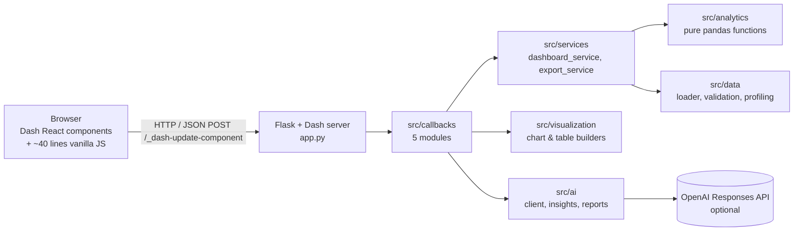
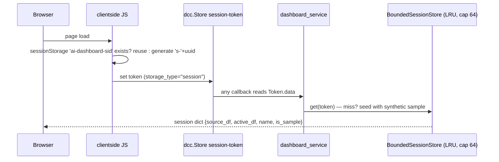
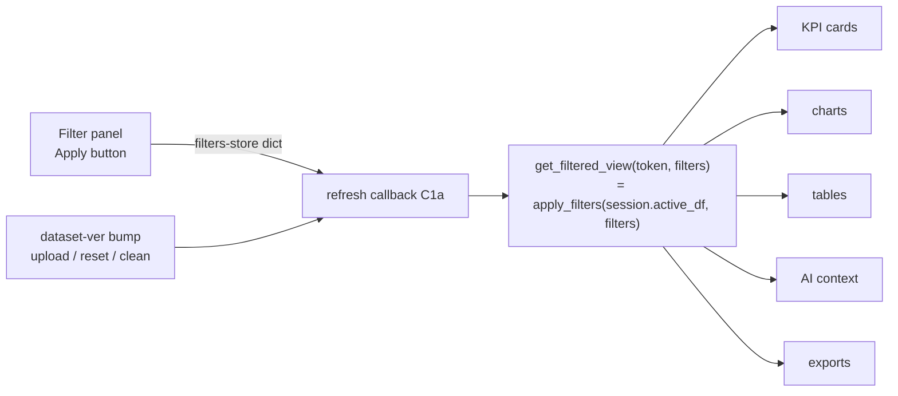
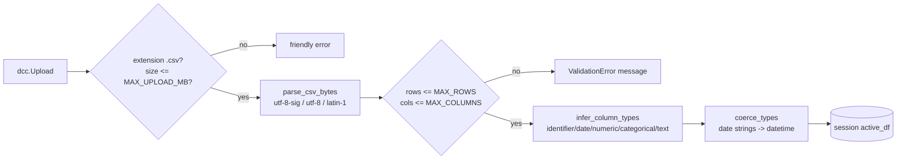

# Architecture

## 1. System overview

The application is a single Python process: a Dash (Flask) web server that owns all
state. There is no separate frontend build and no external database.

Design consequences:

- **Pure-Python analytics.** Every number shown or exported is produced by
  `src/analytics/*` — plain pandas functions with no UI or network dependencies.
  They are unit-testable in isolation and are the *only* source of numbers.
- **The AI interprets, never measures.** `src/ai` receives a bounded, serialized
  summary of computed statistics (see [ai_design.md](ai_design.md)); it cannot
  invent a number that pandas did not compute.
- **Graceful degradation.** No `OPENAI_API_KEY` → every AI call short-circuits to a
  deterministic local summary. API failures are caught, mapped to friendly messages
  and also fall back locally. The dashboard's analytics never depend on the AI path.

## 2. Layers & responsibilities

| Layer | Modules | Responsibility |
|---|---|---|
| Entry point | `app.py` | Dash app, Flask `server`, clientside JS (session token, navigation), callback registration |
| Config | `config/settings.py` | Frozen `Settings` dataclass reading env vars once; the only module that touches `os.getenv` |
| Components | `src/components/*` | Declarative layout pieces; every interactive element has a stable `id` |
| Callbacks | `src/callbacks/*` | Wire inputs→outputs; contain **orchestration only**, no math |
| Services | `src/services/*` | Session store, the single filter pipeline, export payloads |
| Analytics | `src/analytics/*` | KPIs, aggregations, trends, anomalies, correlations, comparisons — pure functions |
| Data | `src/data/*` | CSV decoding/parsing, validation limits, profiling, cleaning, type inference, sample generator |
| Visualization | `src/visualization/*` | Plotly figure builders, `dash_table` builders, theme |
| AI | `src/ai/*` | OpenAI client wrapper, prompts, Pydantic schemas, context building, report narrative |

## 3. State & data flow

### Session model

Uploaded data lives **server-side** in a bounded, thread-safe LRU store. The browser
holds only an opaque UUID4 token.

- Tokens are random UUID4s — one browser can never address another's session.
- LRU eviction bounds memory (`SESSION_STORE_CAPACITY`, default 64 sessions).
- `source_df` (pristine upload) is kept separately from `active_df` (post-cleaning),
  so cleaning can always be re-run from the original.

### Single source of truth for filters

KPIs, charts, tables, the AI context and exports all consume the *same*
`apply_filters()` output — numbers shown in different sections can never disagree.

### Callback store chain

| Store | Written by | Read by |
|---|---|---|
| `session-token` | clientside JS (once, idempotent) | every server callback |
| `dataset-ver` (int) | upload / reset / clean callbacks | refresh + analytics callbacks (change detection) |
| `filters-store` (dict) | filter Apply/Clear callbacks | refresh, AI, exports |
| `ai-history` (dict keyed by dataset signature) | AI answer callback | AI (follow-up context) |
| `ai-last-result` | AI answer callback | status pill, report export |

Pattern-matching inputs (`{"pattern": ...}`) drive the example-question chips in
AI Studio; Dash 4 delivers the triggering id as a JSON string, which the callback
parses defensively.

## 4. Upload & validation pipeline

Uploaded content is treated strictly as data: bytes are parsed by `pd.read_csv` from
an in-memory buffer, never written to disk, never used as a path; filenames are
sanitized (`safe_filename`) to block path traversal.

## 5. Key trade-offs

| Decision | Rationale | Rejected alternative |
|---|---|---|
| In-memory session store | Zero external deps; bounded LRU; data is transient analytics state | Redis/SQLite (ops burden, not needed at this scale) |
| Server-side state, token in browser | Full frames never round-trip through the client; `dcc.Store` stays tiny | Storing DataFrames in `dcc.Store` (payload blow-up, tampering) |
| Pure functions in analytics | Testability + reuse by charts, exports and AI context alike | Methods on mutable app globals |
| Dash 4 with `dash_table.DataTable` | Only table component Dash 4 ships; works without a build step | Custom JS table (needs Node) |
| Flask `server` object exposed | Enables gunicorn/waitress/Docker deployment unchanged | `app.run` in production only |
